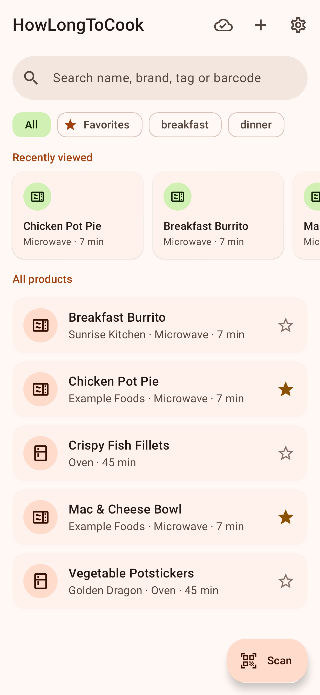
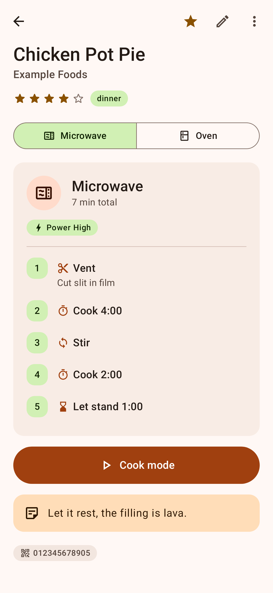
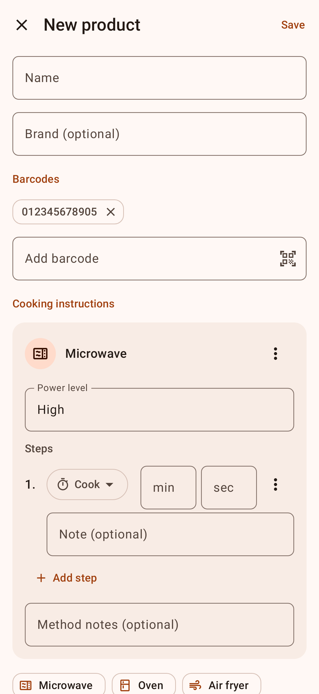
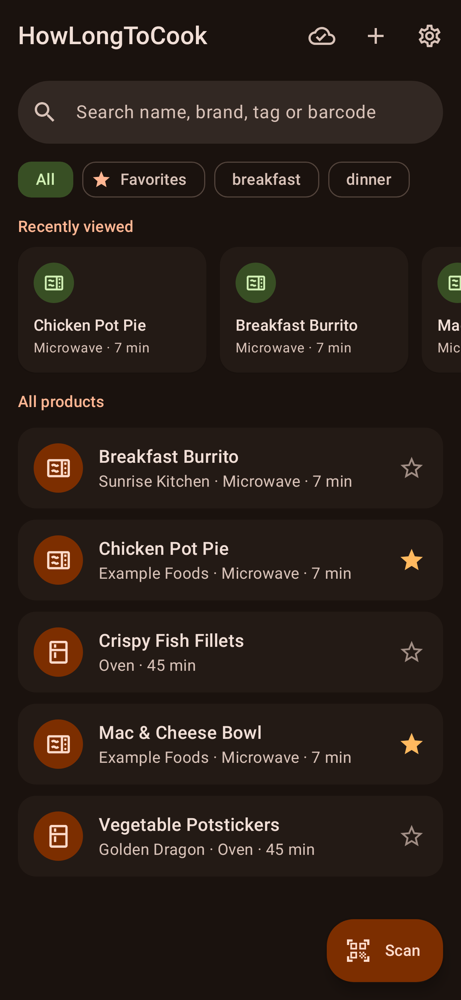
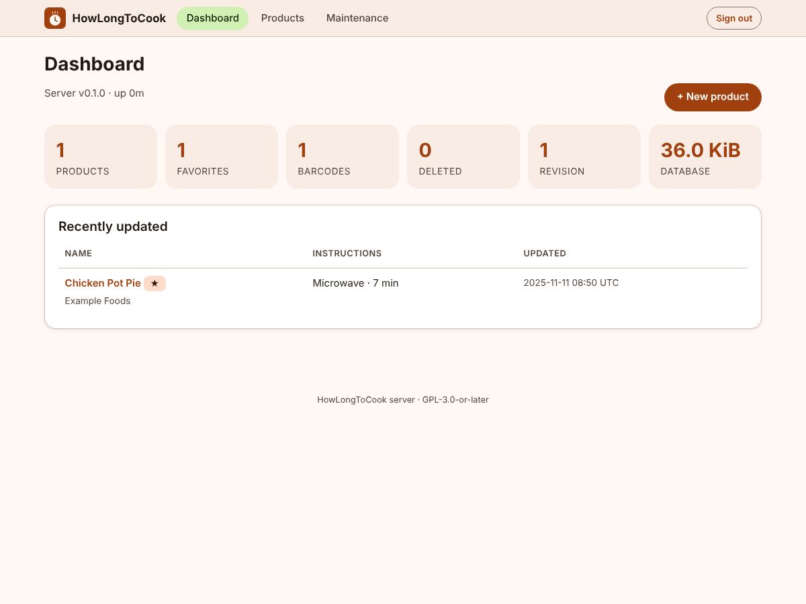
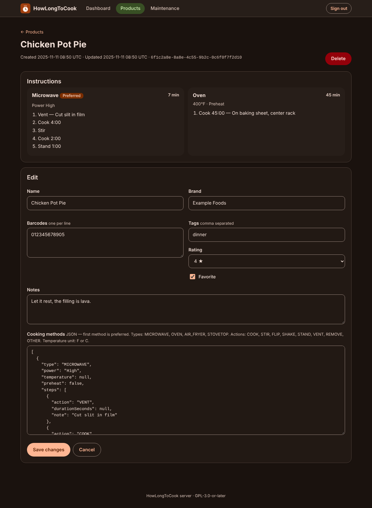
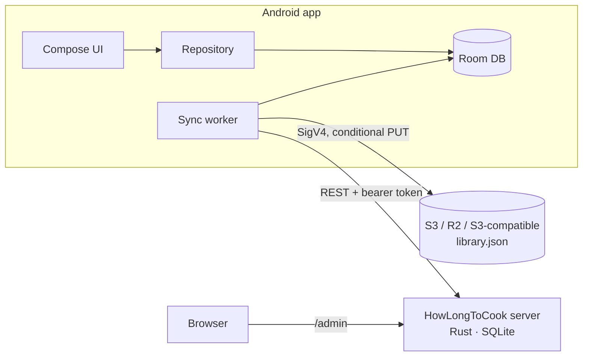

<div align="center">


# HowLongToCook

**Keep the cooking instructions after the box is gone.**

Scan a frozen meal's barcode, save its microwave / oven / air fryer / stovetop steps,
and find them again in seconds, even offline in the garage.

[](LICENSE)


[](AI_DISCLOSURE.md)

[Features](#features) ·
[Screenshots](#screenshots) ·
[Install](#install) ·
[Self-hosting](#self-hosting-the-server) ·
[Contributing](#contributing) ·
[AI disclosure](#ai-disclosure)

</div>

---

## Why?

Packaged and frozen meals print their cooking instructions on an outer box that goes
in the recycling, while the individually wrapped item stays in the freezer for months.
HowLongToCook stores those instructions per product, keyed by **barcode** and **name**,
so you can scan or search and get cooking.

## Features

- 📷 **Barcode scanning** with an open-source scanner (ZXing + CameraX), a torch toggle and manual entry
- 🍽️ **Structured instructions** for microwave, oven/toaster oven, air fryer and stovetop:
  power or temperature, preheat, and ordered steps (cook, stir, flip, shake, stand…)
- 🔍 **Fast search** across names, brands, tags and barcodes, plus favorites and recently viewed
- 👩‍🍳 **Cook mode**: large text, screen stays on, tap steps off as you go
- 🌡️ **°F / °C** shown in your preferred unit, snapped to the steps oven dials use
- 🏷️ **Open Food Facts lookup** fills in name and brand for new barcodes (opt-out)
- ☁️ **Your storage, your choice.** Data stays on the device and syncs in the background to:
  - Amazon S3
  - Cloudflare R2
  - any S3-compatible store (MinIO, RustFS, Garage, Backblaze B2, Wasabi…)
  - the self-hosted **HowLongToCook server**
- 🔐 **Private by default**: no accounts, no telemetry; credentials encrypted with the Android Keystore
- 🎨 **Material 3** with a warm custom palette, light and dark themes, optional colors from your wallpaper
- 💾 **JSON export/import** for backups that don't depend on any service

## Screenshots

<table>
  <tr>
    <td align="center"><br><sub>Library</sub></td>
    <td align="center"><br><sub>Instructions</sub></td>
    <td align="center"><br><sub>Editor</sub></td>
    <td align="center"><br><sub>Dark theme</sub></td>
  </tr>
</table>

<details>
<summary>Server admin UI</summary>
<br>


</details>

> The screenshots are rendered from the real Compose UI with Roborazzi
> (`./gradlew testDebugUnitTest -Pscreenshots`).

## How it works



Edits are saved locally first and pushed in the background. Each product carries an
`updatedAt` timestamp, and the newer version wins on every backend. Deletes are kept
as tombstones so they reach all devices. See [`docs/DESIGN.md`](docs/DESIGN.md) for
the full design.

## Repository layout

| Path | What |
|---|---|
| [`android/`](android) | Android app: Kotlin, Jetpack Compose, Hilt, Room, Ktor, WorkManager |
| [`server/`](server) | Optional sync server with an admin UI: Rust, axum, sqlx/SQLite, askama |
| [`api/`](api) | OpenAPI contract and shared JSON examples used by both test suites |
| [`deploy/`](deploy) | Docker Compose and Kubernetes examples |
| [`docs/`](docs) | Design document and images |

## Install

Download the latest release from the [Releases page](../../releases/latest):

- **Android app:** `HowLongToCook-<version>.apk`. Open it on your phone and allow installs
  from your browser or file manager when asked. Requires Android 12 or newer.
- **Server (optional):** `docker pull ghcr.io/stevenpg/howlongtocook-server:latest`. See
  [Self-hosting](#self-hosting-the-server).

Every release includes a SHA-256 checksum and build-provenance attestations; see
[RELEASING.md](RELEASING.md#verifying-a-release) to verify them.

## Building from source

### Requirements

| Tool | Version |
|---|---|
| JDK | 17 or newer |
| Android SDK | platform 37 (Android Studio installs it) |
| Rust | stable, 1.85 or newer |
| Docker | optional, for the local dev stack |
| [`just`](https://just.systems) | optional task runner |

### Android app

Open the `android/` folder in Android Studio and run the `app` configuration, or:

```sh
cd android
./gradlew installDebug          # build and install on a connected device/emulator
./gradlew testDebugUnitTest     # JVM tests
```

### Server

```sh
cd server
HLTC_TOKEN="$(openssl rand -hex 32)" cargo run
# API:   http://localhost:8080/api/v1
# Admin: http://localhost:8080/admin  (sign in with the token)
```

### Local stack for testing both sync modes

```sh
just dev-up      # server + RustFS (S3-compatible) with a bucket created
```

From the Android emulator, the host is `10.0.2.2`:

| Settings → Storage | Values |
|---|---|
| Self-hosted server | URL `http://10.0.2.2:8080`, token `dev-token-change-me` |
| S3-compatible | endpoint `http://10.0.2.2:9000`, region `us-east-1`, bucket `howlongtocook`, key `hltc`, secret `hltc-dev-secret` |

Run `just` to list every recipe (build, test, check, dev-up/down…).

## Self-hosting the server

The server is optional. Use it if you'd rather not keep data in a cloud bucket.

- **Docker:** see [`deploy/docker`](deploy/docker) for `docker run` and a hardened
  Compose example
- **Kubernetes:** see [`deploy/kubernetes`](deploy/kubernetes) for a kustomize base
  (single replica; SQLite allows only one writer)
- **Configuration:** set `HLTC_TOKEN` or `HLTC_TOKEN_FILE`; full table in
  [`server/README.md`](server/README.md)

Put it behind a TLS-terminating reverse proxy if it is reachable outside your home network.

## Privacy

HowLongToCook has no analytics, ads or accounts. Data leaves the device only to:

1. the storage you configure, and
2. Open Food Facts: only the scanned barcode, only for new products, and only if the lookup is turned on.

## Roadmap

- [x] Signed APK releases and a container image on GHCR
- [ ] Continuous integration on pull requests
- [ ] arm64 server image (Raspberry Pi)
- [ ] F-Droid metadata
- [ ] Translations (all UI text is already in string resources)
- [ ] Optional cook timers
- [ ] Photo of the instruction panel with on-device OCR

Ideas welcome; please open a [feature request](../../issues/new/choose).

## Contributing

Contributions are welcome! Please read [CONTRIBUTING.md](CONTRIBUTING.md) for the
development setup, coding standards and pull-request process, and follow the
[Code of Conduct](CODE_OF_CONDUCT.md).

Found a security issue? Please follow [SECURITY.md](SECURITY.md) and don't open a public issue.

## AI disclosure

Much of this project was written with the help of an AI coding assistant (Claude Code),
under the direction of the maintainer. Read [AI_DISCLOSURE.md](AI_DISCLOSURE.md) for what
that covers, how the code is checked, and the policy for AI-assisted contributions.

## Acknowledgements

- [Open Food Facts](https://world.openfoodfacts.org) for the open product database
- [ZXing](https://github.com/zxing/zxing) for barcode decoding
- [RustFS](https://github.com/rustfs/rustfs) for the S3-compatible dev store
- The Jetpack Compose, axum, sqlx and askama communities

## License

HowLongToCook is free software: you can redistribute it and/or modify it under the terms
of the [GNU General Public License v3.0 or later](LICENSE).
